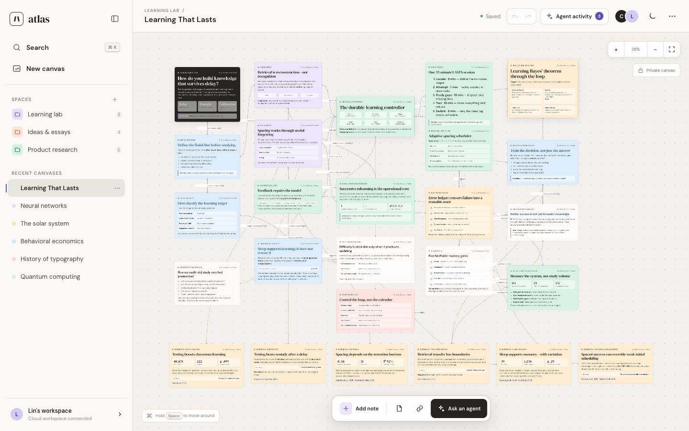

# Atlas Knowledge Canvas

Atlas is a persistent, visual research canvas designed for humans and AI agents to build shared knowledge outside a chat thread.



## Highlights

- Intent-first onboarding that turns a question or project into a guided starting map
- Universal capture for thoughts, questions, and URL sources
- Full card editing, real Spaces, cross-canvas search, labeled relationships, and a minimap
- Embedded **Ask Atlas** workflow with scoped prompts and preview-before-apply proposals
- Durable, attributed activity history with accept, reject, and undo controls
- Infinite spatial canvas with draggable, editable research cards
- Semantic, geometry-aware relationships between claims, evidence, questions, and decisions
- Multiple canvases, search, pan, zoom, responsive fitting, dark mode, undo, and export/import
- Durable cloud workspaces backed by Netlify Blobs
- Authenticated Atlas Agent API and Streamable HTTP MCP adapter
- Downloadable `atlas-canvas` skill plus public agent discovery and OpenAPI documents
- Agent attribution and transaction audit history

The production app is available at [atlas-knowledge-canvas-lin.netlify.app](https://atlas-knowledge-canvas-lin.netlify.app/).

## Local development

```bash
npm install
npm run dev
```

The Netlify Vite plugin emulates Functions and Blobs in local development. If the project is not linked to a Netlify site with AI Gateway available, **Ask Atlas** automatically uses a deterministic offline proposal so the complete review workflow remains testable.

Run the automated checks with:

```bash
npm test
npm run build
```

The production AI function uses Netlify AI Gateway and defaults to `gpt-5.4-mini`. Set `ATLAS_MODEL` to another model supported by the Gateway to change it without modifying code.

Create a production build with:

```bash
npm run build
```

## Agent integration

In Atlas, open **Canvas menu → Agent integrations** and copy the private connection bundle. An agent should inspect the workspace before writing, use small attributed transactions, and never expose or persist the bearer token.

Public discovery endpoints:

- `/.well-known/atlas-agent.json`
- `/openapi.json`
- `/agent/atlas-canvas/SKILL.md`
- `/agent/atlas-canvas.skill`

Supported durable operations include creating canvases and nodes, updating nodes and relationships, connecting knowledge, and explicitly authorized deletion.

## Deployment

The included `netlify.toml` builds the Vite app and deploys the Atlas and MCP serverless functions from `netlify/functions`.
